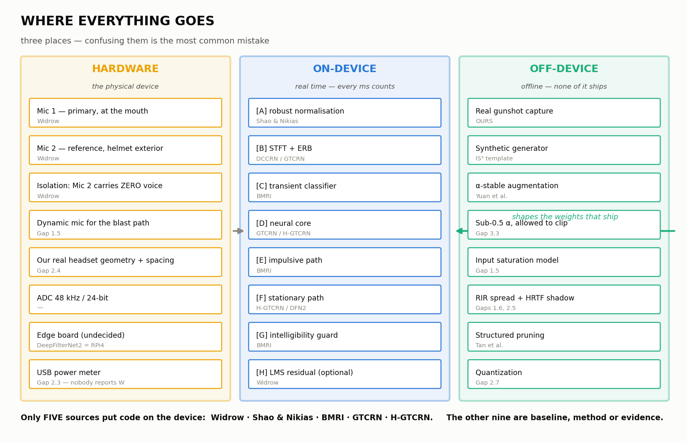

# Where everything goes

Every paper, technique and note mapped to the exact block it lands in.



[`ORDER.md`](order.md) is *when*. [`WORKFLOW.md`](workflow.md) is *why*. This is
**where** — including which things become hardware, which become code that ships
on the device, and which never leave the training machine.

---

## The one distinction that matters

Three different places, and confusing them is the most common mistake:

| | Runs where | Latency budget | Contains |
|---|---|---|---|
| **HARDWARE** | The physical device | — | Mics, placement, ADC, board |
| **ON-DEVICE** | The board, in real time | **Every millisecond counts** | The signal path only |
| **OFF-DEVICE** | Your training machine, offline | Unlimited | Data generation, training, pruning, evaluation |

α-stable augmentation, the synthetic generator, pruning, every metric — **none
of it ships**. It shapes the weights that ship. A judge asking "isn't that too
heavy for embedded?" about α-stable noise generation has misunderstood the
question, and you should be able to say why in one sentence.

---

## 1. HARDWARE — what physically goes in the device

The full parts list, ports and wiring are in
[`../../synthetic_generator/HARDWARE.md`](../../synthetic_generator/HARDWARE.md).
This table shows where each hardware decision comes from.

| Block | Final design | From |
|---|---|---|
| **Mic 1 — primary** | Boom on the left earcup, 2–5 cm from the mouth | **Widrow**; left side keeps it clear of a right-shouldered rifle (3M ComTac VIII practice) |
| **Mic 2R — reference** | Outside the right earcup, opposite the boom | **Widrow** — must contain almost no voice, or the system learns to remove the voice |
| **Mic 4 — throat** | Laryngophone on the neck | **INVISIO** body-conducted voice principle — a voice path airborne gunfire cannot enter |
| **Mic 2L, Mic 3L, Mic 3R** | Outside left; inside left and right | Two-eared hear-through (**Peltor / Apple**) and hybrid ANC error sensors |
| **Mic type** | High-overload MEMS (135 dB) outside; low-noise MEMS inside | **Gap 1.5** — mic saturation is modelled by nobody; we choose for it and train on it |
| **Earmuff** | 3M PELTOR Optime III, SNR 35 dB, passive | Protection must work with the power off (EN 352 ratings are measured unpowered) |
| **Lane A board** | ADAU1787 DSP + STM32 | Anti-noise must beat sound to the ear (≈ 0.3–0.6 ms) |
| **Lane B board** | Jetson Orin Nano Super, TensorRT | PS names Jetson and TensorRT; **GTCRN** at 25K parameters keeps it small |
| **ADC** | 48 kHz / 24-bit (UMC404HD; ADAU1787 internal) | Resampled to the model's 16 kHz |
| **Power measurement** | `tegrastats` on the Jetson | **Gap 2.3** — nobody in the literature reports watts |

**The team owns the mechanical decisions** (mic positions, sealing, the
voice-leak test): software cannot fix them afterwards.

---

## 2. ON-DEVICE — the real-time signal paths

Two lanes; the detail is [`architecture.md`](architecture.md) §4–§5.

**Lane A (ADAU1787, both ears):** clip detect → hear-through band filter →
level-dependent gain → crack guard → 82 dB limiter; feed-forward + feedback
ANC; mixer; output limiter.

**Lane B (Jetson):**

```
  Mic 1 ──┐
  Mic 2R ─┼──► [B1] capture ─► [B3] robust normalisation ─► [B4] STFT + ERB
  Mic 4 ──┘         │                                              │
                    └─► [B2] impulse detector              ┌───────┴────────┐
                        [B5] scene classifier ──► modes    ▼                ▼
                                                    [B6] BMRI repair   [B7] GTCRN, 3 inputs
                                                           └───────┬────────┘
                                                            [B8] merge ─► [B9] voice guard
                                                                   ─► [B10] residual LMS (optional)
                                                                   ─► [B11] ISTFT ─► radio
```

| Block | What it does | From | Why here |
|---|---|---|---|
| **[B3] Robust normalisation** | Scale on the 90th percentile or a fractional lower-order moment. **Never RMS** | **Gap 2.2 + cross-finding B**; FLOM from **Shao & Nikias (1993)**, cited inside Yuan et al. | RMS is undefined for α-stable noise (α < 2). MEASURED on our 44 events: RMS drifts 18×, FLOM 5.7× |
| **[B4] STFT + ERB** | Complex STFT (512 / 256 at 16 kHz), ERB compression to 129 features | **DCCRN** (complex), **GTCRN** (ERB) | Phase matters; ERB cuts compute |
| **[B5] Scene classifier** | Kurtosis + stationarity + level → mode for both lanes, γ and β for BMRI | **BMRI Innovation 1** made live | **The "adaptive" the PS demands** |
| **[B7] GTCRN** | Complex ratio mask on the boom mic from 3 inputs | **GTCRN (ICASSP 2024)**; extra channels from **H-GTCRN**; throat channel from **INVISIO** | The **AI/ML** the PS requires; 25,109 parameters |
| **[B6] BMRI repair** | AR detect + interpolate on flagged frames, short cracks only | **BMRI (Ruhland et al. 2015)** | **Prediction fails on impulses** (cross-finding A) — detect and react |
| **[B9] Voice guard** | Restores voice bands the throat envelope says were spoken | **BMRI's spectral correction**, formalised | Intelligibility must be *preserved* |
| **[B10] Residual LMS** | Optional final adaptive stage | **Widrow** | Only if it measurably helps |
| **[B11] ISTFT** | Back to waveform, to the radio | — | — |

**Which models ship:** only **[B7] GTCRN** is learned. BMRI, the classifier,
normalisation, the guard, and all of Lane A are classical.

---

## 3. OFF-DEVICE — data pipeline

None of this runs on the device. All of it shapes the weights that do.

| Step | What | From |
|---|---|---|
| **Real gunshot capture** | 96 kHz/24-bit, staggered gain, calibrated to Pascals, range IR, 9 quality checks, frozen reference | **Ours** — [`DETAILS.md`](../02-data-collection/details.md). Not from any paper, deliberately |
| **Synthetic generator structure** | Real + synthetic sources, onset detection to strip impulses from backgrounds, standardised labels | **IS³** — their data-generation pipeline is the template. They faced our exact problem: no standard dataset existed, so they built one |
| **Blast waveform model** | Friedlander wave — sharp rise, positive phase, negative underpressure | **Currently uncited.** Already in `make_test_data.py`. Needs a source (see ORDER.md §1b) |
| **Public noise** | Rotor, vehicle, siren, wind, HVAC | DEMAND, MUSAN, UrbanSound8K, ESC-50, NOISEX-92 |
| **Mixing at SNRs** | Include **−12.5 to −2.5 dB**, not just 0 to +20 | **NOISEX-92** gives the SNR framework; **H-GTCRN** shows that negative range is where gunfire actually lives |
| **α-stable augmentation** | Replace Gaussian augmentation, α ≈ 1, several separate α values (beats blending) | **Yuan et al. (2023)** |
| **Sub-0.5 α, allowed to clip** | Generate below their α floor and let it saturate | **Gap 3.3** — they set α ≥ 0.5 because clipping compromised *their* results. For us clipping **is the physics**. We use the regime they excluded, for the reason they excluded it |
| **Input saturation model** | Saturating function applied to the mic signal in the pipeline | **Gap 1.5** — mirrors Deep ANC's loudspeaker SEF at the opposite end of the chain |
| **Structured bursts** | Heavy-tailed arrival and amplitude, but with a real attack/decay envelope | **Gap 3.6** — their α-stable noise is i.i.d. samples; a real gunshot has structure over tens of milliseconds |
| **γ from SNR** | Derive the dispersion parameter from target SNR instead of sweeping | **Gap 3.5** — they call choosing γ an open problem. In images there is no natural scale; **in audio there is: SNR** |
| **RIR spread** | Near-anechoic (open field) through hard-walled (vehicle interior) | **Gap 1.6** — Deep ANC used one room, 3×4×2 m, T60 0.15–0.25 s, fixed geometry |
| **HRTF head shadow** | Published HRTF data instead of a flat scalar | **Gap 2.5** — Tan et al. scale the secondary channel by a flat −10..0 dB. Real head shadow is strongly frequency-dependent |

---

## 4. OFF-DEVICE — training

| Element | Choice | From |
|---|---|---|
| **Paradigm** | Supervised, noisy/clean pairs | **Wang & Chen (2018)** |
| **Target** | Mask (IRM-family) rather than direct spectrum | **Wang & Chen** |
| **Applied to** | The **noisy input**, not a pre-separated estimate | **H-GTCRN ablation** |
| **Dual-channel conditioning** | Feed **both** separated-speech and separated-noise channels | **H-GTCRN ablation** — the largest single gain in their study |
| **Inputs** | Boom + reference + throat as channels; throat dropout ≈ 30 % | **H-GTCRN** (extra channels), **INVISIO** (throat) |
| **Loss** | SI-SNR + L1 on real/imag/magnitude + multi-resolution spectrogram loss | **Tan et al.**, **DeepFilterNet2** |
| **Loss (stretch)** | Fractional lower-order moments | **Cross-finding C** — squared error is ML-optimal for Gaussian residuals; under heavy tails one impulsive sample drags the gradient more than a second of speech. **Stretch goal, must not block anything** |
| **Speech corpus** | **LibriSpeech + Lombard GRID on disk**; Hindi (SPRING-INX) pending | English no longer blocks this stage — `synthetic_generator/DATASET_SPEC.md` §3 |

---

## 5. OFF-DEVICE — compression

| Step | What | From |
|---|---|---|
| **Structured pruning** | Sparse group lasso, iterative prune-then-finetune. Whole groups, because hardware can skip them; scattered zeros still get multiplied | **Tan et al.** — 290.44K → 103.07K with little quality loss |
| **Quantization** | The study they never did | **Gap 2.7** — note the interaction: prune→quantize ≠ quantize→prune, and enhancement is sensitive to reduced precision |
| **α-stable vs prune-ability** | Two identical models, one Gaussian-augmented one α-stable, prune both, plot quality vs parameter count | **Gap 3.4** — α-stable training produces sparser models (6.16% / 7.13% vs 3.02% on MNIST-C) and they never pruned. **One experiment, two deliverables** |
| **Export** | ONNX / TensorRT | PS requirement |

---

## 6. Evaluation

| Metric | Where it comes from | Target |
|---|---|---|
| SNR / SI-SNR | PS | > 15 dB |
| STOI | PS | > 0.85 |
| PESQ | PS | > 2.5 |
| **NMSE** | **Deep ANC** — their metric, so comparisons are like-for-like | more negative better |
| **DNSMOS SIG** | **Reddy et al. (DNSMOS P.835)**; anchor from GTCRN's DNS3 blind test | **≥ 3.00** |
| **DNSMOS BAK** | **Reddy et al. (DNSMOS P.835)**; anchor from GTCRN's DNS3 blind test | **≥ 3.90** |
| Latency, ms/frame | **Gap 2.3** | real-time on our board |
| **Power, watts** | **Gap 2.3** | nobody reports it |

**Why DNSMOS earns its place:** it splits SIG from BAK, so **over-suppression
becomes visible**. If the filter kills the gunshot (high BAK) but drops SIG
below 3.5, it flags that the device is degrading command clarity. A single SNR
number hides that completely — and over-suppression is the exact failure the
PS's intelligibility requirement exists to prevent.

### The two experiments the story rests on

| Experiment | From | Produces |
|---|---|---|
| **Impulsive evaluation grid** | **Gaps 1.1 + 2.1** | Deep ANC was never tested on impulsive noise; Tan et al. trained and tested **only on babble**. Run both on a proper taxonomy and report where they hold and where they break |
| **Latency vs prediction horizon** | **Gap 1.2 + cross-finding A** | One chart, stationary and impulsive on the same axes. Deep ANC loses 1.5–1.7 dB per 10 ms bought back — on *periodic* noise. If the impulsive curve falls off a cliff, that chart justifies the entire two-path architecture |

---

## 7. Every source, and its job

| Source | Job in our system | Ships on device? |
|---|---|---|
| **Widrow (1975)** | Two-mic architecture, mic placement, isolation constraint, LMS residual | **Yes** — [B10], and the hardware layout |
| **NOISEX-92 (1993)** | SNR framework, the noise set everyone inherits — and its blind spot | No — evaluation framing |
| **Shao & Nikias (1993)** | Fractional lower-order moments for [B3] | **Yes** — [B3] |
| **BMRI / Ruhland (2015)** | Impulsive path [B6], intelligibility guard [B9], adaptive γ [B5] | **Yes** — three blocks |
| **Wang & Chen (2018)** | Supervised paradigm, mask targets | No — training method |
| **DCCRN (2020)** | Complex-domain processing in [B4] | Concept only |
| **Deep ANC (2021)** | **Baseline to attack.** Its gaps give us 2.1, 2.2, 2.4, 2.8. NMSE metric | No — baseline |
| **Tan et al. dual-mic (2021)** | **Baseline to attack.** Pruning method. Its gaps give us 2.3, 2.5, 2.6, 2.7 | No — baseline + pruning method |
| **FullSubNet (2021)** | Full-band + sub-band structure in [B7] | Concept only |
| **DeepFilterNet2 (2022)** | Deep filtering in [B7] (future deep-filtering head), loss design, embedded feasibility proof | Concept + comparison |
| **Yuan et al. α-stable (2023)** | Augmentation, and the clipping regime we invert | No — training only |
| **GTCRN (2024)** | **The neural core [B7]** | **Yes** |
| **H-GTCRN** | Multi-channel form of [B7]; mask on the noisy input | **Yes** |
| **IS³ (2025)** | Synthetic data pipeline template, two-stage filtering | No — data method |
| **Our range data** | The reference the generator is validated against | No — but it is what makes the dataset claim real |

**Only five sources put code on the device:** Widrow, Shao & Nikias, BMRI,
GTCRN and H-GTCRN. Everything else is method, baseline or evidence.

That is worth knowing before a judge asks "you listed fourteen papers — which
ones are actually in the product?"
